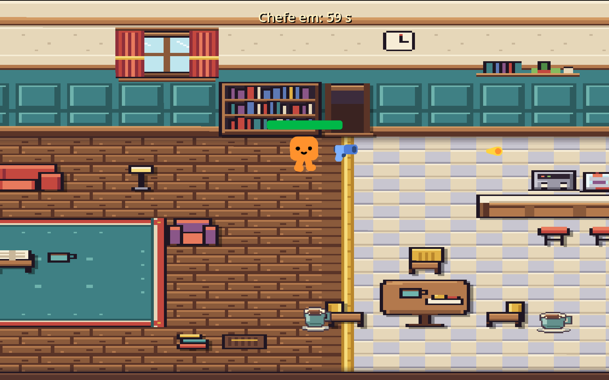

# Cafeteria com Xícaras Saltitantes

Projeto acadêmico desenvolvido para Jogos Digitais II, em 2026, utilizando Godot 4.7 e GDScript.

## Carta do projeto

- Tema: Cafeteria com xícaras saltitantes
- Tipo: Chefe
- Modo: Horda (visão de cima)

## Sobre o jogo

O jogador controla HappyBoo em uma cafeteria invadida por xícaras inimigas.

O objetivo inicial é sobreviver durante 60 segundos. Após esse tempo, surge uma xícara gigante como chefe final, com vida própria e um ataque especial de três projéteis de café.

O jogador vence ao derrotar o chefe e perde quando sua vida chega a zero.

## Captura de tela

## Controles

- W: mover para cima
- A: mover para a esquerda
- S: mover para baixo
- D: mover para a direita
- A arma mira e dispara automaticamente.
- F11: alternar tela cheia.
- Esc: voltar ao modo janela.

## Funcionalidades

- Movimentação em quatro direções.
- Animações do personagem.
- Sistema de vida e dano.
- Arma e projéteis automáticos.
- Horda de xícaras inimigas.
- Navegação para contornar obstáculos.
- Paredes e móveis com colisão.
- Temporizador de 60 segundos.
- Chefe final com barra de vida.
- Ataque especial do chefe.
- Condições de vitória e derrota.
- Câmera acompanhando o jogador.
- Testes de mecânicas do jogo.

## Origem do projeto

O desenvolvimento começou com o tutorial da GDQuest:

**Your First 2D GAME From Zero in Godot 4 — Vampire Survivor Style**

https://www.youtube.com/watch?v=GwCiGixlqiU

O tutorial foi utilizado como base para estudar e construir as mecânicas iniciais do jogo.

Inicialmente, foram utilizados os recursos gráficos disponibilizados no projeto-base, como HappyBoo, Slime, pistola, projéteis, árvores e efeitos.

Posteriormente, o projeto foi adaptado ao tema sorteado pelo professor: **Cafeteria com xícaras saltitantes**.

A adaptação incluiu o novo cenário, xícaras inimigas, colisões com móveis, navegação por obstáculos, temporizador, chefe final e condição própria de vitória.

## Como executar

1. Abrir o gerenciador de projetos da Godot.
2. Importar o arquivo `project.godot`.
3. Abrir o projeto.
4. Pressionar F5 para jogar.

## Uso de inteligência artificial

O OpenAI Codex foi utilizado como ferramenta de apoio para desenvolvimento em GDScript, correções, navegação dos inimigos, implementação do chefe, testes e melhorias de desempenho.

Os trechos identificados com `[CODEX]` registram partes do código desenvolvidas ou modificadas com essa assistência.

O ChatGPT também foi utilizado para orientação técnica e documentação.

O uso dessas ferramentas não substitui o estudo e a compreensão do código.

## Créditos e licenças

### GDQuest — tutorial e recursos iniciais

Tutorial:
https://www.youtube.com/watch?v=GwCiGixlqiU

Projeto-base:
https://github.com/gdquest-demos/getting-started-with-godot-4

- Código original: licença MIT.
- Assets gráficos do projeto-base: CC BY-NC-SA 4.0.
- Recursos inicialmente utilizados: HappyBoo, Slime, arma, projéteis, árvores e efeitos.

### hopefulsham — cenário da cafeteria

Pacote: Corner Cafe & Bookshop.

https://hopefulsham.itch.io/corner-cafe-free-tileset

A licença incluída com o pacote permite utilizar e modificar os recursos em jogos comerciais e não comerciais, mas proíbe redistribuí-los isoladamente como pacote de assets.

Arquivo de licença original:
`assets/CornerCafe/CornerCafe/LICENSE.txt`

### Outros recursos

Os sprites das xícaras e quaisquer outros recursos externos devem ter suas respectivas origens e licenças verificadas e registradas antes da publicação.

### Ferramentas

- Godot Engine: https://godotengine.org/
- OpenAI Codex.
- ChatGPT.

## Diário de desenvolvimento

O histórico de implementação, dificuldades, soluções e testes está registrado em [DEVLOG.md](DEVLOG.md).
